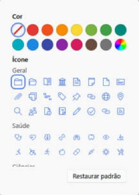

# 🎨 Coleções Coloridas Zotero

Extensão para o Zotero que permite personalizar a cor e o ícone das coleções.

> **Projeto independente e não oficial. Não possui vínculo com o Zotero ou a Corporation for Digital Scholarship.**



## ✨ Recursos

- 🎨 14 cores prontas e uma cor personalizada
- 🗂️ 72 ícones organizados por área: Geral, Saúde, Ciências, Tecnologia, Humanidades e Sociais, Artes e Linguagens
- 📚 Aplicação em várias coleções de uma só vez
- 🔄 Atualização automática pelo próprio Zotero
- 🌐 Interface em português, inglês, espanhol, francês, alemão, italiano e chinês
- 🖥️ Compatível com o Zotero 7 ou superior, no Windows, macOS e Linux

## 🚀 Como Instalar

1. **Baixe a extensão:**
   Acesse a seção **Releases** deste repositório e baixe o arquivo `colecoes-coloridas-zotero.xpi` da versão mais recente.

2. **Abra o gerenciador de extensões:**
   No Zotero, acesse **Ferramentas → Extensões**.

3. **Instale o arquivo:**
   Clique na engrenagem ⚙️, escolha **Install Plugin From File…** e selecione o arquivo baixado.

4. **Pronto!**
   A extensão já está ativa, sem precisar reiniciar o Zotero.

## ▶️ Como usar

1. Clique com o botão direito em uma coleção.

2. Escolha **Cor e ícone…**

3. Clique em uma cor e/ou em um ícone. A mudança aparece na hora.

4. Para voltar ao visual original, clique em **Restaurar padrão**.

*Dica: no Zotero 8 ou superior, selecione várias coleções antes de abrir o menu para aplicar a mesma cor ou o mesmo ícone em todas.*

## ☝️ Privacidade

- Nenhum dado é enviado para servidores externos.

- As cores e os ícones ficam salvos apenas nas preferências do Zotero no seu computador.

- Itens, coleções e a sincronização do Zotero não são alterados.

## 📁 Estrutura

```text
colecoes-coloridas-zotero/
├── src/
│   ├── manifest.json
│   ├── bootstrap.js
│   ├── icon.svg
│   ├── icons/
│   └── locale/
├── images/
└── updates.json
```

### Arquivos

`src/manifest.json`
Identificação e compatibilidade da extensão.

`src/bootstrap.js`
Lógica do menu, do painel e da exibição dos ícones.

`src/icons/`
Ícones disponíveis no painel.

`src/locale/`
Textos da interface em cada idioma.

`updates.json`
Informações usadas pelo Zotero para atualizar a extensão.

## ⚠️ Observações

- As personalizações não são sincronizadas entre computadores nem compartilhadas em bibliotecas de grupo.

- Ao desativar ou remover a extensão, as coleções voltam ao visual original.

- Testado no **Zotero 10.0.6** (Windows).

- Os ícones vêm do [Zotero](https://github.com/zotero/zotero) (AGPL-3.0) e do [Tabler Icons](https://tabler.io/icons) (MIT). Veja [`src/icons/LICENSE.md`](src/icons/LICENSE.md).

## 📄 Licença

[AGPL-3.0](LICENSE)
